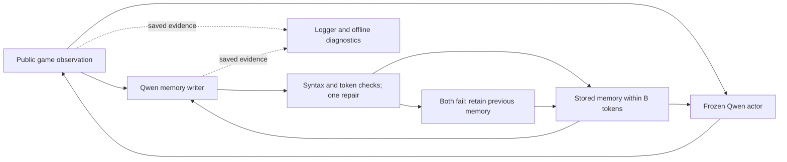

# Design proposal: evaluating memory constraints in prose and JSON

Prepared November 15, 2026 against commit
`739e72def5ef65d8e0a8fd24d879cdc401de2066`.
**Status: proposed for your review. No experiment code changes or new runs are
authorized by this document.** File assignments below are suggested briefs for
the Codex sessions you intend to delegate later.

**Recommendation**

Keep CookingWorld, Qwen, the runner, and the existing memory interfaces. Change
the memory policy so that Qwen writes both representations and Python enforces
only their syntax and token limits. Give both the same repair opportunity and
the same fallback: retain the previous valid memory. Measure performance at a
tight and a generous memory allowance, with everything else fixed.

First establish whether limiting memory changes the behavior of these two
systems. Then add recovery price as a second experimental factor. Use separate
diagnostics to understand whether failures come from omitted facts, incorrect
facts, or the actor failing to use correct facts. This avoids building another
successful cooking agent whose programmed assistance obscures the memory question.

The initial engineering work fits in the current architecture. The main changes
are in `memory.py`, a small actor revision, experiment identity, and analysis.
No new inference backend, simulator, framework, dependency, dashboard, general
scheduler, or resume mechanism is needed.

**1. What the evidence establishes**

The [reproduction report](reproduction-2026-11-15.md) and
[saved summary](../artifacts/reproduction-v29-v16-20261115/summary.json) establish:

| Finding | Consequence for the next experiment |
| --- | --- |
| Prose won 4/4, but all 30 prose memory updates came from coded fallback. | Those wins do not establish that a model-written prose notebook works better. |
| JSON accepted 34/36 model replacements, including contradictory inventory and invented completion. | Syntax validity is different from factual correctness. We need to measure both separately. |
| Maximum stored memories were 115 prose tokens and 122 JSON tokens under a 256-token limit. | The limit was respected, but binding memory pressure has not been demonstrated. |
| Outcomes, actions, rereads, and token totals matched across prices within a format/seed. | Charging a higher price worked; a behavioral recovery-price effect was not observed. |
| All eight traces passed technical audits and the setup suite passed 313 tests. | Reuse the infrastructure. Technical correctness does not settle the research design. |

Being below the limit does not prove the limit had no influence: writers know the
allowance and may compress proactively. Conversely, an omitted fact below the
limit does not prove unavoidable capacity loss. We need an actual intervention
on the allowance and inspection of the resulting memories.

**2. State the question precisely**

There are two useful questions with different designs:

| Question | Suitable experiment | Claim it supports |
| --- | --- | --- |
| How does a smaller token allowance affect a model-managed prose agent versus a model-managed JSON agent? | Matched complete games, varying format and allowance under a shared update policy. | Performance of these complete writing/reading systems under token constraints. This is the recommended primary study. |
| Are the same facts easier to store or read in prose versus JSON? | Controlled, equivalent-fact encodings and paired reader decisions. | Encoding overhead and reader sensitivity for those facts and states. This is a diagnostic extension. |

Equal token allowances do not mean equal information content. JSON keys and
punctuation consume part of its allowance; that overhead is legitimately part of
the first question. Model choices about what to keep, formatting reliability,
and reader behavior are also part of that system-level result. We must describe
that scope rather than calling it an isolated effect of punctuation.

Recommended primary endpoint: game success. Recommended primary comparison:
**whether reducing memory causes a different success-rate change for the two
formats**. Recovery actions, factual retention, score, and inference cost explain
the mechanism; they are not substitutes for the declared primary endpoint.

**3. Proposed memory policy: Qwen chooses the facts**

The next policy, provisionally `p1-memory-v17`, should follow this specification.
The exact version is reserved only after confirming no other session has used it.

| Decision | Proposed rule | Why |
| --- | --- | --- |
| Writer evidence | Previous rendered memory, executed action, latest observation, public goal, remaining game budget, reread price, and memory allowance. | These permitted inputs already exist. No hidden recipe archive or fact tracker is needed. |
| Shared instructions | Ask both writers to prioritize the remaining recipe, carried items, confirmed progress, and information needed for later decisions. Allow compression and omission when space is tight. | Give equivalent guidance without guaranteeing facts will survive. |
| Prose format | Plain natural-language memory, rendered verbatim. Remove the required `Carried items` / `Recipe progress` template. | The existing exact two-line instruction coincided with outputs containing only those lines. It also imposes a semantic structure that JSON does not share. |
| JSON format | One model-managed JSON object; retain the existing declared canonicalization and value-preservation rules. | Changing to a fixed task schema would introduce a separate schema intervention. |
| Content validation | Do not reject a syntactically valid, within-limit candidate for dropping a recipe, stale inventory, or wrong progress. | Those are the failures this experiment needs to observe. Requiring the whole recipe at every allowance can make a tight-budget experiment impossible by construction. |
| Syntax and size | Enforce valid text/JSON and the complete rendered token limit. Retain strict JSON parsing, Unicode checks, and exact accounting. | These define the allowed representations and capacity, not a cooking solution. |
| Repair | At most one call to the same Qwen, with the same evidence and a syntax/size reason. No Python-generated inventory or progress hints. | Equal intervention policy; JSON may still need more repairs because syntax robustness is part of its performance. |
| Failed repair | Return the exact previous valid state. At initialization this means the format's empty state. | A shared neutral fallback adds no new facts. Its consequences remain measured. |
| Empty memory | Empty prose and `{}` are permitted, counted outcomes. | Accepted output is not automatically useful output. Report empty writes and their information quality. |
| Infrastructure failures | Model, tokenizer, transport, or runtime exceptions remain visible infrastructure errors. | They must not be disguised as memory fallback or game losses. |

Remove the live use of `_validate_prose_facts`, `_validate_structured_facts`,
the public-fact fallback builders, and their fact-specific repair hints from this
new policy. Keep the v16 source snapshot and artifacts as the historical baseline.
There is no need to add a permanent runtime switch for every historical writer
version; replay v16 from its pinned commit when needed.

Keep `MemoryStrategy`, `MemoryContext`, and `MemoryUpdate` unchanged if possible.
The existing events and raw responses already support acceptance/fallback
accounting. Code may normalize declared JSON syntax; it must not fill inventory,
restore a recipe, advance progress, or choose a next action for either format.

An immediate fall in prose success is possible and acceptable. Equal rules do
not require equal success, acceptance, or fallback rates. The acceptance criterion
is that both methods actually implement the declared experiment.

Define prose as concise natural-language sentences or bullet notes in its prompt,
and JSON as the declared object representation. Check actual format adherence
offline as well as syntax: a prose writer can return JSON-shaped text that still
passes a UTF-8 check. Record that as nonadherence in its assigned condition; do
not relabel or discard the episode after seeing its result. Persistent format
nonadherence during calibration means the intended manipulation is not yet
established, even if the acceptance counter is high.

Other plausible changes answer different questions:

| Alternative | Benefit | Limitation / recommendation |
| --- | --- | --- |
| Fix the prose prompt but keep current fact helpers | Could make the writer retain more recipe text. | Leaves unequal semantic checks and recovery assistance; insufficient as the research fix. |
| Give both formats the same programmed fact tracker | Makes assistance more symmetric. | Evaluates two renderings of a largely programmed memory policy. Useful as a labeled diagnostic, but does not establish model-written memory quality. No tracker may keep extra facts outside the allowance. |
| Require the same task schema in both formats | Makes factual slots easier to align and score. | Introduces schema guidance as another intervention. A viable separate design if chosen explicitly; fields must permit omission/unknown values at small allowances. |
| Shared syntax/size checks with model-selected content | Preserves actual writer choices under a known capacity constraint. | Recommended primary design; factual and syntax failures remain part of measured performance. |

**4. Actor and information boundary**

Use one actor policy across all memory conditions, provisionally `s2-action-v30`.
Keep the v29 model-based meal review and unavailable-action repair, with every
call logged and charged. Make one focused prompt change: when a required recipe
fact is absent or uncertain, permit the actor to recover it through an available
cookbook action instead of assuming the recipe is retained. Use the same wording
for both formats, and do not ban rereads or filter legal repeats.

The actor must use the supplied context to identify facts. It must not depend on
specific prose headings or JSON keys. General appliance/mechanics instructions
may remain shared; ingredient names, recipes, and solutions must come from the
public episode evidence. The same substantive actor instructions should also
work with the explicitly labeled full-history diagnostic context.

The memory allowance limits persistent factual state, not the whole prompt.
The current observation, legal actions, goal, budget, and price remain public
inputs. Keep them identical for matched states. A recipe is directly visible
immediately after reset or a reread; success on that turn alone is not evidence
of retention. Inspect decisions after intervening observations have replaced it.

The actor currently maintains an inspection-result cache even though v29 does
not use it to block choices. Do not describe that as a demonstrated input leak.
For the new bounded path, bypass unused factual cache maintenance and test that
prior observations cannot affect a decision except through supplied memory.
Any plan retained for a later turn must live inside the declared memory allowance.



The logger has no return path to the actor or writer. An offline evaluator may
read the full public trace to judge factual retention; that history is never
returned as agent assistance.

**5. Establish meaningful memory pressure before freezing the grid**

Calibration is development work, separately labeled and excluded from the final
comparison. Start with the current one-room/two-ingredient game and train-fold
seeds 0/1. Keep Qwen revision, FP16, greedy decoding, generation seed, output
limits, game budget 80, and price 2 fixed while calibrating memory.

Use candidate allowances **32, 64, 128, and 256 tokens**. These are proposed
calibration points, not proven tight/generous levels. Tokenize small equivalent
public-fact examples first to identify obvious format overhead; then inspect
actual model-written memories and gameplay. Examples are diagnostics, not gold
memory injected into the production agent.

Calibration should answer the following in order:

1. Can the frozen actor solve both preselected games with full visible history?
   Run the existing full-history diagnostic under the new actor. It is a
   capability reference, not another bounded-memory treatment or a guaranteed
   mathematical upper bound. Record context-limit failures separately.
2. At a generous allowance, do both writers produce useful memory? Inspect
   recipe requirements, carried items, and progress at named checkpoints. A
   suggested engineering gate is at least 90% of updates accepted from primary
   or repaired model output, on at least ten updates per format across the two
   development recipes. Freeze that gate before calibration. Also check content:
   100% accepted empty or useless notes do not qualify as a functioning writer.
3. At a smaller allowance, do the writers change retained information, show
   capacity-related rejection/repair, or require more recovery? Inspect decisions
   whose needed facts are absent from the current observation. Near-limit token
   usage alone does not establish harmful forgetting; a loss alone does not
   establish capacity as its cause.
4. Select one common tight allowance `L` and one common generous allowance `H`
   using these development observations, then freeze them for both formats.
   **64 and 256 are initial candidates, not automatic final choices.** A smaller
   allowance must at least accommodate a valid, meaningful note in both formats;
   do not manufacture a win by choosing a limit below JSON's minimum valid shape.

A functioning high-budget writer need not win every game. The gate distinguishes
an unusable implementation from a memory comparison; it must not be used to
drop failing seeds or require the desired format ranking. Preserve every
calibration failure and version every prompt or task change.

If the current recipes remain easy to represent at all useful limits, change
one task setting in a new calibration condition: first consider three ingredients
in one room, which the existing engine/configuration already support. Recheck
full-history capability. Do not add more rooms, forced distractions, an artificial
delay wrapper, and a smaller action budget together. Additional navigation is a
later option because it also changes exploration and recovery effort.

If both formats fail at generous memory, diagnose writing/reading capability
before enlarging the experiment. If tighter memory changes nothing, retain the
null result and reconsider task suitability; do not keep altering the test split
until a preferred difference appears. Even a tight-budget effect establishes
the behavior of these writers, not that no better encoding could fit the facts.

**6. Proposed experiment stages and scope**

| Stage | Matched conditions | Purpose |
| --- | --- | --- |
| Calibration and controls | Separately labeled diagnostics on development instances; no preset success-ranking target. | Select viable task and common `L`/`H`; establish real writer use and capability. |
| First development comparison | 2 formats × 2 allowances × seeds 0/1, at price 2 = **8 games**. | Directly test the new memory-constraint question with the smallest matched grid. |
| Recovery-price extension | Add the same eight cells at price 5 = **16 games total**. | Determine whether recovery price changes the allowance/format result. |
| Later held-out study | With `N` seeds, 4N games at one price, or 8N at both prices. | Estimate general performance and uncertainty after task/policy freeze. |

This proposes replacing the first eight-game grid's price axis with memory
allowance, then restoring both prices in the extension. **That changes the active
MVP plan and needs your design decision before implementation/launch.** If the
original recovery-cost question must be answered in the next milestone, use the
16-game development grid from the outset. Calibration games and full-history
controls are additional and never pooled with those cells.

The first two seeds are implementation diagnostics, not a publishable estimate
of general success. Repeating deterministic runs of the same seed does not add
independent game instances. For a later study, choose the sample size and target
precision before opening held-out games. Use a disjoint held-out fold/seed list,
retain all planned instances, and freeze tuning. For illustration, `N=20` would
mean 80 or 160 games, not the existing 120-game protocol. This is not a request
to schedule either study now.

Keep the initial free recipe, action budget, and available-action policy fixed
within each grid. If price 5 changes only the budget ledger while actions and
success remain identical, report that. An 80-unit budget may leave recovery cheap
relative to short games; a behavioral price effect is not guaranteed. Do not
quietly add action-budget tuning as another treatment after seeing results.

**7. What to measure and how to interpret it**

| Measurement | Definition and use |
| --- | --- |
| Primary outcome | Success on each matched game seed. Record terminal failure and budget exhaustion separately. |
| Gameplay | Score, actions, invalid attempts, rereads, budget spent, and repeated-action patterns. A failed game remains an outcome. |
| Writer use | Primary acceptance, repaired acceptance, previous-state fallback, and accepted empty memory, each divided by memory updates. |
| Capacity | Stored tokens divided by allowance; raw candidate and canonical rendered candidate sizes; over-budget rejection frequency; generation-limit hits. Invalid JSON has no valid rendered size and must be labeled accordingly. |
| Factual memory quality | Supported required facts retained, omitted facts, contradicted facts, and invented facts at fixed checkpoints. Score inventory/progress accuracy as well as recipe coverage. |
| Reader use | At an annotated decision, was the needed fact present and correct in stored memory or current observation? Was the action consistent with it? Facts missing elsewhere in the full trace do not count as available to the actor. |
| Delay/recovery | Number of rewrites since a required fact was last observed; reread requested when information is missing versus already present. Use annotation, not reread count alone, to infer recovery. |
| Inference cost | Calls and input/output tokens by actor/writer/review/repair, generation time, episode time, and model loading separately. Include rejected generations. |

Start with small public-evidence checklists for both development recipes, at
reset, after taking an ingredient, after a preparation, and before meal
preparation or a terminal mistake. Record supporting trace event IDs and mark
ambiguous cases unknown. Report retained supported facts against required facts,
and incorrect claims against inspectable claims separately, so empty memory is
not rewarded for making no false claims. Avoid an unvalidated automatic LLM judge.

No semantic-quality annotation changes memory, rejects a write, repairs an
action, or stops a valid game. Technical audit failures stop subsequent runs;
unwelcome gameplay results do not. If low allowances mostly cause invalid JSON
and fallback, report a representation-validity limitation; do not present it
solely as forgotten recipe facts. Do not remove such episodes from the primary
analysis to make the formats look equally reliable.

For success, compute each format's matched difference:

```text
allowance effect for format F = mean(success[F, H] - success[F, L])
interaction = allowance effect for JSON - allowance effect for prose
```

A positive interaction means JSON loses more success when memory is tightened
under this policy/task. Report the direct JSON-minus-prose comparison at each
allowance too. In a larger study, uncertainty must resample whole matched seeds
with all their conditions together. Two development seeds support descriptive
tables and trace explanations, not strong significance claims. Two allowance
levels also do not establish the shape of a performance curve; add an intermediate
level only if that becomes an explicit later question.

**8. Optional diagnostic for a narrower format claim**

When the game results are hard to interpret, select a few saved public decision
states. Have a reviewer prepare the same supported facts in concise prose and
JSON, with equivalent content and ordering, no suggested next action, and no
hidden simulator state. Count each encoding with Qwen's tokenizer.

Where both encodings fit the same allowance, present each to the same frozen
actor with the exact same current public view and measure the decision. Where
one does not fit, record that as encoding feasibility rather than silently
dropping facts from one side. Select states where the current observation and
legal actions do not themselves reveal the required recipe method.

This is an explicitly labeled controlled-reader diagnostic, not production
memory and not a normal episode result. It can distinguish reading difficulty
from unequal retained content for those cases. It does not reproduce repeated
rewriting or closed-loop gameplay. A public-fact checklist or full history must
never become an undeclared memory store for the real bounded agent. Defer a new
probe harness until the basic eight-game comparison demonstrates a need.

**9. Impact on the current program**

| Files / subsystem | Proposed change | Expected impact |
| --- | --- | --- |
| `game_memory/memory.py` | New shared writer instructions; prose/JSON syntax-and-size policy; remove active semantic interventions; shared previous-state fallback; version metadata. | Main behavior change. Fewer coded helpers, but success may decrease. Preserve numeric/syntax/bounds/accounting safeguards. |
| `game_memory/actor.py` | New shared recovery-aware prompt; preserve logged model reviews; bypass unused factual caching in new bounded path. | Small policy change, frozen across all new conditions. No scripted action substitution. |
| `components.py`, `contracts.py` | Prefer no interface change. Existing allowance/context/update interfaces suffice. | Limits integration risk and lets existing fake/model adapters remain useful. |
| `runner.py` | Retain turn order, exact memory guard, raw traces, accounting, and termination. Only a small shared source-digest helper move if launch identity needs it. | The execution core already does the needed job. |
| `pilot.py`, `run_episode.py` | Include selected memory metadata and protocol identity before loading weights; verify them on reuse. Move memory selection early enough for preflight identity. | Current pilot manifest records actor/model/episode/source but not memory metadata explicitly; fix that demonstrated reproducibility gap. |
| `summarize_diagnostics.py` | Add writer-provenance, empty-memory, repair, and fallback summaries from existing events. Retain strict per-condition technical checks. | New evidence without a live fact oracle. Missing legacy fields remain unknown rather than fabricated. |
| One focused analysis module | Proposed `game_memory/analyze_memory_budget.py`, using existing audit/inspection helpers; group by format, allowance, price, and seed; produce JSON/CSV/Markdown. | Justified because current `analyze_3x2.py` assumes hybrid, 20 seeds, and one allowance. No generic experiment framework. Test analysis functions directly. |
| `environment.py`, Qwen adapter | Reuse current behavior. | No new environment mechanic, training, retrieval service, or inference backend. |
| Notebooks/local launch script | After the CLI is verified, update explicit configuration to the selected protocol. | Keep notebooks as launchers. Do not silently turn a capability check into the experiment. |
| `evaluate_3x2.py`, old protocol/analysis | Leave the 120-game path deferred; only adapt a caller if a shared preflight signature changes. | Avoid accidental reuse of its fixed-budget/hybrid assumptions. It is not the new study's launcher. |

For identity, freeze the memory prompt/update policy, actor/review policy,
rendering rules, tokenizer/model revision, output/context limits, task, fold,
seeds, allowance, price, and action budget. Store the protocol and source digest
beside each new grid. A Git SHA plus `worktree_dirty: true` alone cannot prove
that executable source stayed constant. Reuse the existing source-digest approach
through a small shared helper rather than importing the deferred evaluation
launcher into the normal pilot path.

Use a small root `comparison-manifest.json` to declare the exact expected formats,
allowances, prices, seeds, task, versions, model/runtime settings, and source and
protocol identities. The analysis should derive expected cells from that file,
not guess the grid from whichever results happen to exist. Keep each condition
in a separate directory, for example
`artifacts/memory-budget-v1/comparison/prose-b64-p2/`; use separate roots for
calibration and any changed settings. The existing CLI already accepts the
allowance and multiple seeds, so these directories need no new batch engine.

Existing episode files and manifests remain unchanged. New manifest schema/policy
versions must reject adoption of old directories. Existing baseline tests that
assert v16 semantic fallback describe a retired behavior: preserve them with the
pinned baseline, or explicitly version them if that implementation is retained.
Replace active-policy expectations with meaningful v17 behavior tests; keep all
independent syntax, exact-boundary, numeric fidelity, isolation, and accounting
checks. Do not simply delete failing safeguards to get a green suite.

**10. Task plan and acceptance criteria**

| ID | Task | Depends on | Reviewable completion criterion |
| --- | --- | --- | --- |
| T0 | Approve the question, policy, version names, metadata/event contract, and 8-versus-16-game next milestone. | This design review | One written protocol distinguishes calibration, comparison, and held-out work. No ambiguity about coded assistance or permitted evidence. |
| T1 | Implement the shared memory policy. | T0 | Both formats receive the same evidence/priorities; valid omissions are accepted; both fail to previous state after one repair; no coded facts are inserted. |
| T2 | Implement the recovery-aware frozen actor. | T0 | Missing recipe information can lead to a legal reread; useful facts do not trigger a forced reread; no hidden historical cache affects the new path; all review/repair calls remain accounted. |
| T3 | Strengthen preflight identity. | T0, agreed T1 metadata | Memory/prompt/protocol/source changes are rejected before GPU load; allowance changes require a fresh condition; old manifests and results remain immutable. Update all searched callers. |
| T4 | Implement constraint-aware analysis and provenance metrics. | T0, agreed events | Exact planned cells required; duplicates/partial/error cells explicit; budgets/versions cannot be silently pooled; writer/fallback/empty counts reconcile with raw events. |
| T5 | Add public-evidence annotation fixtures and instructions. | T0 | At least two recipe checklists have supported fact IDs and checkpoint rules; empty, contradictory, correct, and ambiguous memories produce distinct assessments. No annotation enters agent prompts. |
| T6 | Integrate and run relevant/full automated checks. | T1–T5 | Tests cover invalid/oversized writes, valid forgotten facts, neutral fallback, exact bounds, no hidden inputs/state, metadata mismatch, and incomplete-grid analysis. CPU/fake checks are labeled appropriately. |
| T7 | Perform capability/writer/pressure calibration. | T6 | Inspect real Qwen gameplay first; demonstrate useful actual writer output at a generous allowance; select common `L`/`H` or document why this task cannot yet support the question. All attempts preserved. |
| T8 | Freeze and run the new development grid sequentially. | T7, protocol decision | First episode inspected before continuing; all planned cells retained, audited, and independently token-counted; no prompt/task tuning within the grid. |
| T9 | Produce the comparison table, two annotations, and artifact handoff. | T8 | Report successes/losses, allowance effects, provenance/content errors, and measured inference cost; ZIP/checksum and source/protocol snapshots available in durable shared storage. Unknown launcher exit statuses are flagged. |
| T10 | Decide whether a larger held-out study or controlled-reader probe is justified. | T9 | Explicit decision based on capability, pressure, and evidence quality. No automatic 120-game launch. |

Important new tests include a prose candidate that omits the recipe and remains
accepted, and a JSON candidate with semantically wrong but structurally valid
progress that also remains accepted. Their purpose is to verify the experimental
boundary, not to reward bad memory. Offline annotations should identify the
quality failures in both. Tests must also show that a failed repair leaves the
prior state byte-for-byte unchanged and that initialization never injects the
recipe through fallback.

Each session runs tests relevant to its owned behavior. After integration, run:

```sh
PYTEST_DISABLE_PLUGIN_AUTOLOAD=1 .venv/bin/python -m pytest -q
```

Real-Qwen calibration follows those checks; a green fake-model suite is not a
substitute for verifying useful writer output or memory pressure.

**11. Suggested delegation to separate Codex sessions**

Agree on T0 first. Then these implementation assignments can proceed with
separate file ownership; none should independently tune prompts or start GPU jobs.

| Session | Owns | Handoff and boundaries |
| --- | --- | --- |
| A — memory policy | `memory.py`, `tests/test_memory.py`, `tests/test_memory_integration.py`, `docs/p1-memory.md` | Implement T1. Publish policy metadata and event names first. Preserve interfaces and evidence boundaries. Do not edit actor, launchers, or runner. |
| B — actor policy | `actor.py`, `tests/test_actor.py`, `docs/actor-policy.md` | Implement T2 using the agreed memory contract. Keep policy identical across formats and keep inference accounting through the supplied model. Do not tune on held-out games. |
| C — evidence and analysis | `summarize_diagnostics.py`, its tests, proposed `analyze_memory_budget.py` and its tests, annotation fixture files | Implement T4/T5 against existing traces and synthetic failure fixtures. Do not add online semantic validators or change memory interfaces. Distinguish baseline v16 and the new policy in reports. |
| D — integration owner | `pilot.py`, `run_episode.py`, identity-related `runner.py` changes, pilot/CLI/caller tests, protocol and launcher docs | Implement T3, coordinate T6–T9, and own any signature-only adaptation in `evaluate_3x2.py`. Incorporate A/B/C after contract review. Be the sole GPU operator and evidence-directory owner. |

Dependency order: A/B/C may implement after the contract is agreed; D can build
preflight guards in parallel against that contract. Integration precedes real
calibration; calibration precedes the frozen comparison. This proposal does not
spawn those sessions, create worktrees, commit changes, or launch jobs. The
repository currently requires the existing isolated checkout; use disjoint files
and an integration owner, and do not assume separate sessions provide separate
filesystems or GPUs.

In a shared checkout, sessions must not switch branches or stage/commit one
another's edits. Run the final suite against a stable integrated revision, then
freeze that revision before the GPU owner starts calibration or comparison jobs.
Do not create worktrees unless you explicitly request them.

**12. Design decisions for your evaluation**

| Decision | Recommended choice | Tradeoff |
| --- | --- | --- |
| Main scientific question | Complete agent performance under equal token allowances. | Practical and minimally invasive; includes writer/reader/format reliability rather than isolating syntax alone. |
| Semantic assistance | Remove live fact validation/repair for both; annotate facts offline. | Allows real forgetting and factual mistakes; gameplay success may fall. |
| Writer schema | Model-managed prose and JSON with shared content priorities. | Avoids introducing a fixed-schema confound; JSON may choose inconsistent keys, which remains measured behavior. |
| First comparison | Eight games at fixed price 2, varying format and two calibrated allowances. | Keeps the first checkpoint small; answering the recovery-price question requires the sixteen-game extension. |
| Task difficulty | Start with the current game; increase ingredients only if calibration requires it. | Reuses known mechanics and avoids navigation confounds; may expose that the current game is too easy or the writer too weak. |
| Controlled identical-fact probe | Defer until the primary pilot needs a narrower explanation. | Saves scope now; a pure representational claim remains unsupported without it. |

The desired result is an interpretable experiment, including a possible null
effect or poor performance in both formats. If you adopt this design, delegate
T1–T6 first. Passing those checks establishes readiness for T7 calibration; its
evidence determines the task and allowances to freeze before T8–T9. The old 4/4
versus 0/4 table remains a baseline with unequal assistance. This report proposes
future work; no implementation or experiment launch has been performed for it.

**Research context and limits**

[DSSR](https://arxiv.org/abs/2609.32805v2) separates limits of a short state from
loss caused by the writer's choices, including in cooking games with controlled
information delay. That motivates separating capacity pressure from writing
mistakes here; its training protocol and reported success rates are not being
adopted or transferred to this Qwen pilot.

[LongMemEval](https://arxiv.org/abs/2410.10813v2) distinguishes stages of memory
processing, including reading. [Lost in the Middle](https://arxiv.org/abs/2307.03172v3)
shows that having relevant information in context does not ensure reliable use
across positions. These support inspecting retention and reader behavior
separately; neither paper establishes which format or allowance will work best
in this program. The proposed settings, gates, and task assignments are design
judgments grounded in this repository's observed failures, not published results.
